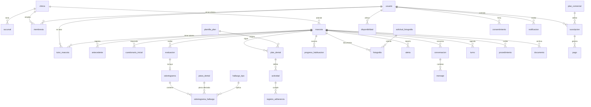

# DentaPet Care — Modelo de datos

Esquema PostgreSQL del MVP, pensado para correr sobre Supabase. Implementa el §31 del brief (entidades mínimas), el §30 (seguridad, auditoría, separación por clínica) y los límites de rol del §3.

**Estado:** las 12 migraciones aplican limpio sobre PostgreSQL 16 y la suite de `db/tests/pruebas.sql` pasa sus 66 aserciones. Ver [`db/README.md`](db/README.md) para correrlo.

---

## 1. Las cinco decisiones que condicionan todo lo demás

### 1.1. El aislamiento entre clínicas vive en la base, no en la aplicación

Toda tabla clínica lleva `clinica_id` y tiene RLS activa. Una consulta mal escrita en el portal no puede filtrar de más porque la base no le devuelve las filas. El test lo verifica desde el rol `authenticated`, igual que la API: la clínica B consulta al paciente de la clínica A y recibe cero filas.

Sin esto, el aislamiento depende de que cada `select` de cada endpoint recuerde el `where`. En un producto con datos clínicos de terceros, eso no es aceptable.

### 1.2. La asistente pertenece a la clínica pero no es clínica

El §3.4 del brief dice qué **no** puede hacer la asistente: diagnosticar, prescribir, modificar indicaciones clínicas, interpretar fotografías, firmar. Esconder botones no es un control de acceso.

La distinción se implementa con dos funciones distintas:

- `app.pertenece_a(clinica)` → cualquier miembro, incluida recepción y administración.
- `app.es_clinico_de(clinica)` → solo `veterinario_generalista` y `veterinario_odontologo`.

Las tablas clínicas (`evaluacion`, `odontograma`, `plan_dental`, `procedimiento`, revisión de `fotografia`, clasificación de `alerta`) usan la segunda. Las administrativas (`turno`, `conversacion`, registro de pacientes) usan la primera.

Un detalle que importa al escribir los tests: una escritura bloqueada por RLS **no lanza excepción en un UPDATE** — afecta cero filas. "Prohibido" e "invisible" se prueban distinto.

### 1.3. Ningún estado clínico se asigna solo

Tres reglas del brief se convirtieron en triggers, no en validaciones de cliente:

| Regla | Dónde vive |
|---|---|
| Una fotografía solo cambia de `pendiente_revision` si la revisa un profesional de esa clínica (§12) | `app.validar_revision_fotografia` |
| Un plan solo se activa firmado por un veterinario de esa clínica (§23) | `app.validar_activacion_plan` |
| Una alerta solo cambia de estado si la clasifica un profesional (§13) | `app.validar_clasificacion_alerta` |

El motivo es concreto: si esas reglas vivieran solo en la interfaz, un job de migración, un webhook o un bug podrían emitir una señal clínica sin supervisión humana — exactamente lo que el brief prohíbe. Con el trigger, ningún cliente puede hacerlo, ni siquiera por error.

El nivel de riesgo tiene la misma lógica: se escribe únicamente en `evaluacion.nivel_riesgo`, y el cuestionario inicial no tiene columna de puntaje. La app no puede mostrar un riesgo que ningún profesional definió porque no existe dónde guardarlo.

### 1.4. La adherencia se calcula sobre ocurrencias esperadas

`app.adherencia(mascota, desde, hasta)` genera las ocurrencias que el plan activo esperaba en el período y las cruza contra los registros. Si se calculara sobre los registros existentes, un tutor que nunca abre la app tendría 100% de adherencia — y ése es justamente el paciente que hay que detectar. El test lo fija: sin registros, 0%.

El ejemplo del §7 del brief ("cuatro de siete") se verifica: `57.1`.

Los motivos de incumplimiento son un enum cerrado, no texto libre, porque alimentan las métricas del §20. Y dos de esos motivos —`dolor` y `sangrado`— no son falta de tiempo: son signos clínicos, así que disparan una alerta automática hacia la bandeja del profesional. Es la única alerta de origen `sistema` del MVP, y no clasifica nada: solo levanta la mano.

### 1.5. El consentimiento no es un booleano

`consentimiento` guarda el texto versionado, su hash, la fecha, la IP y el user agent. Un booleano en la tabla de usuarios no prueba **qué** aceptó la persona cuando el documento cambió tres veces. Frente a un reclamo bajo la Ley 25.326, la diferencia es material.

---

## 2. Mapa de entidades

Las tablas de catálogo (`pieza_dental`, `hallazgo_tipo`, `etapa_habituacion`, `producto`, `contenido_educativo`) y `auditoria` se omiten del diagrama por claridad.

---

## 3. Migraciones

| Archivo | Contenido |
|---|---|
| `0001_base.sql` | Extensiones, esquema `app`, roles, `app.uid()`, 25 tipos enumerados |
| `0002_tenencia.sql` | Clínicas, sucursales, usuarios, membresías y las funciones de autorización |
| `0003_mascotas.sql` | Mascotas, vínculo con tutores, antecedentes, cuestionario inicial |
| `0004_odontograma.sql` | Catálogo Triadan, catálogo de hallazgos, evaluación, odontograma y sus validaciones |
| `0005_planes.sql` | Plantillas, planes, actividades, adherencia, habituación |
| `0006_fotos_alertas_mensajes.sql` | Fotografías con estados, signos de alarma, mensajería |
| `0007_turnos.sql` | Disponibilidad, turnos sin sobreturno, procedimientos |
| `0008_suscripciones.sql` | Planes comerciales, suscripciones, pagos, idempotencia de webhooks |
| `0009_contenidos_documentos_notificaciones.sql` | Biblioteca, documentos, consentimientos, política anti-fatiga |
| `0010_auditoria.sql` | Auditoría genérica por triggers sobre 22 tablas |
| `0011_rls.sql` | RLS y políticas de todas las tablas |
| `0012_seed_catalogos.sql` | 126 piezas dentales, 37 hallazgos, 5 etapas, 2 planes, 9 plantillas |

---

## 4. Detalles que conviene conocer antes de tocar el esquema

### Identidad

`app.uid()` es el único punto que sabe de dónde sale el usuario autenticado: lee el JWT de Supabase o, si no hay, el GUC `app.usuario_actual` (tests y jobs). Cambiar de proveedor de auth toca una función.

### Vínculo automático del titular

Al insertar una `mascota`, un trigger vincula a quien la creó como titular — salvo que sea personal de la clínica, porque el §3.4 permite que recepción registre pacientes y no corresponde hacerla tutora. Sin este trigger, entre el `insert` de `mascota` y el de `tutor_mascota` la fila queda huérfana y ni su creador la ve.

### Turnos

`EXCLUDE USING gist (profesional_id WITH =, rango WITH &&)` hace imposible el sobreturno incluso con dos clientes concurrentes; no hay ventana de carrera que un chequeo en la aplicación pueda cubrir. Un trigger adicional verifica que el turno caiga dentro de una franja de disponibilidad vigente. `app.franjas_libres()` alimenta la pantalla de disponibilidad de la app.

### Suscripciones

`suscripcion` es la fuente de verdad. Los webhooks de RevenueCat y Mercado Pago escriben ahí normalizando a los mismos estados, y `evento_pago_externo` da idempotencia: los dos proveedores reintentan entregas, y sin esa tabla un reintento duplica pagos o revive una suscripción cancelada. Ni `suscripcion` ni `pago` tienen política de escritura para `authenticated`: solo entra por `service_role`.

### Auditoría

Un trigger genérico sobre 22 tablas guarda fila anterior, fila nueva y **la lista de campos que cambiaron** — eso último hace legible el historial en el portal sin diffear dos `jsonb` en el cliente. Un `UPDATE` que no cambia nada no se audita. La tabla es de solo lectura para todos: la lee el superadmin y el admin de la clínica auditada, y nadie la escribe (el `insert` lo hace el trigger, que es `SECURITY DEFINER`).

### Política anti-fatiga

`app.puede_notificar(usuario, canal, momento, origen_clinico)` es el punto único del §10: franja horaria, tope diario según nivel de insistencia, y excepción para lo clínico. **Toda** notificación tiene que pasar por ahí. Si la regla se dispersa en cada punto de envío, se viola sola en tres meses: alguien agrega un módulo que manda push y nadie se entera. Cuando una notificación se suprime, queda registrada con el motivo — sin eso no se puede auditar por qué un tutor no recibió un aviso.

---

## 5. Lo que este esquema todavía no cubre

Dicho explícitamente para que no se descubra tarde:

- **Storage.** Las políticas de los buckets de Supabase (fotos y documentos) son configuración aparte y hay que escribirlas con el mismo criterio de aislamiento. Las tablas guardan `storage_path`, no URLs.
- **Métricas materializadas.** El dashboard del §20 sobre datos crecientes va a necesitar vistas materializadas o tablas de resumen. Con 100 pacientes las consultas directas alcanzan.
- **Retención y borrado.** El §30 pide eliminación de cuenta y exportación. El esquema tiene los `on delete` puestos, pero falta el procedimiento de borrado que respete la obligación de conservar historia clínica — que es una decisión legal antes que técnica.
- **Programación de recordatorios.** Falta el job de `pg_cron` que materializa las ocurrencias del día en `notificacion` pasando por `app.puede_notificar`.
- **Índices de rendimiento.** Los que están cubren los accesos previstos. Los reales se ven con datos: instrumentar con `pg_stat_statements` durante el piloto.
- **Odontograma:** el esquema está; falta el componente SVG. Ver [`odontograma-triadan.md`](odontograma-triadan.md).
